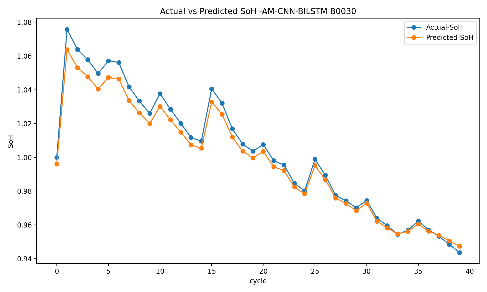
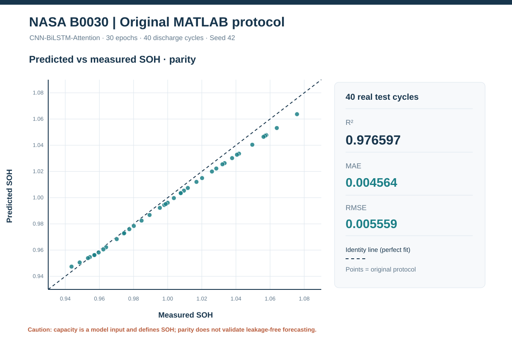

# CNN–BiLSTM with Feature-Wise Attention for Lithium-Ion Battery State-of-Health Estimation

TensorFlow implementation and experimental record for lithium-ion battery state-of-health (SOH) estimation using **NASA Prognostics Center of Excellence (PCoE)** discharge measurements. The repository preserves the archived MATLAB-based experiments and provides a Python command-line pipeline, reproducible dataset preparation, training checkpoints, and versioned evaluation results.

**Experimental scope:** The numerical results below reproduce the **historical notebook protocol**. That protocol has target leakage and test-dependent normalization. Accordingly, its reported accuracy must **not** be interpreted as evidence of leakage-free SOH prediction or cross-battery generalization. A separate, train-only-normalized cycle-level pipeline is provided for method development; it is not a like-for-like reproduction of the MATLAB experiments.

## Recorded experiments

Each run uses the original NASA MATLAB discharge traces, 30 training epochs, a fixed seed of 42, and the **last epoch** for test inference. Predictions are first averaged by discharge cycle; the reported metrics are then calculated across cycles.

| Test cell | Development cells | Test cycles | MAE | RMSE | R² | MAPE |
|---|---|---:|---:|---:|---:|---:|
| **B0018** | B0005, B0006, B0007 | 132 | **0.004402** | **0.005765** | **0.995196** | **0.5563%** |
| **B0030** | B0029, B0032, B0031 | 40 | **0.004564** | **0.005559** | **0.976597** | **0.4449%** |

These are **observed historical-protocol results**, not a statistically controlled comparison between different methods. The two test cells have different operating histories and SOH variances. For a detailed breakdown, source hashes, full-precision metrics, and diagnostic plots, consult the experiment reports.

- [NASA B0018 — complete evaluation report](results/legacy_mat_b0018_e30_seed42/README.md)
- [NASA B0030 — complete evaluation report](results/legacy_mat_b0030_e30_seed42/README.md)

### Observed and estimated SOH

| B0018 (132 test cycles) | B0030 (40 test cycles) |
|---|---|
|  |  |

### Prediction diagnostics

| B0018 | B0030 |
|---|---|
|  |  |

Residuals and training convergence are provided separately: [B0018 residuals](results/legacy_mat_b0018_e30_seed42/signed_residuals_B0018.svg), [B0030 residuals](results/legacy_mat_b0030_e30_seed42/signed_residuals_B0030.svg), [B0018 training curves](results/legacy_mat_b0018_e30_seed42/training_convergence.png), and [B0030 training curves](results/legacy_mat_b0030_e30_seed42/training_convergence.png).

## Model specification

The historical network maps seven observed discharge features to a scalar SOH estimate:

`Seven discharge measurements → Conv1D(64, kernel=3) → MaxPooling1D(2) → Dropout(0.30) → Bidirectional LSTM(100) → sigmoid Dense(200) gate → element-wise multiplication → Dense(1)`

The model is optimized with Adam using mean squared error (MSE) and a batch size of 32. The gate applies feature-wise multiplication to the BiLSTM representation; it is **not** a Transformer attention layer. The original implementation also logs classification accuracy, which is not an informative performance metric for continuous SOH regression. MAE, RMSE, MAPE, and R² are calculated from the cycle-aggregated predictions.

The implementation is in [`legacy_mat_pipeline/`](legacy_mat_pipeline/). The archived source notebooks remain available under [`notebooks/`](notebooks/).

## Data and preprocessing

The historical pipeline uses the **original sample-level MATLAB `.mat` files**, rather than the versioned cycle-level CSV summaries. The official NASA source archive is downloaded and verified before training; the precise source file SHA-256 hashes are included in each run's `config.json`. All source archives and trained model weights are excluded from the Git repository.

Additional processed datasets are available under [`data/processed/`](data/processed/):

- NASA PCoE: 12 battery series, 1,157 cycle-level records.
- CALCE CS2 (University of Maryland): four battery series, 3,921 cycle-level records.

The CALCE tables are data resources; they were **not** used for the two B0018/B0030 historical experiments documented above. See [data provenance](data/README.md), [processing instructions](docs/REAL_DATA_SETUP.md), and the [processed-dataset manifest](data/processed/manifest.json).

## Running the historical MATLAB-based pipeline

After installing the Python dependencies from `requirements.txt` and mounting Google Drive in Colab, execute from the repository root:

```bash
python -m legacy_mat_pipeline --experiment B0018 --run-root /content/drive/MyDrive/NASA_CNN_BiLSTM_Attention
python -m legacy_mat_pipeline --experiment B0030 --run-root /content/drive/MyDrive/NASA_CNN_BiLSTM_Attention
```

The corresponding NASA source `.mat` files are recovered automatically. To reuse a previously downloaded official ZIP, provide `--archive` with its path. Each epoch saves a full Keras checkpoint with optimizer state to the designated persistent run directory; the final two epochs are retained. The model, prediction CSV, metrics JSON, configuration, training history, and figures are saved for each experiment.

The models (`.keras`), checkpoints, and original NASA archives are retained in Google Drive, while the small experimental reports and figures are committed to GitHub.

Reproduction and environment notes: [MATLAB pipeline](REPRODUCE_ORIGINAL_MAT.md) · [Python package instructions](legacy_mat_pipeline/README.md) · [checkpoint recovery](TRAINING_RECOVERY.md).

## Experimental validity and limitations

The archived implementation reproduces choices that would not be acceptable for an independent, leakage-free battery-health forecasting benchmark:

1. **Target leakage:** same-cycle `capacity` is one of the seven network inputs, whereas the SOH label is derived from capacity.
2. **Test-dependent normalization:** the MinMax scaler is refitted on the held-out battery at inference time.
3. **Sample-level validation contamination:** development measurements are randomly split 80/20. Measurements from a single discharge cycle can appear in both the training and validation subsets.
4. **Representation limitation:** the network processes a seven-element feature vector as a sequence; it is not explicitly modeling chronological degradation across cycles.
5. **Limited comparative evidence:** two single-seed historical reruns do not constitute a multi-seed, uncertainty-quantified, cross-dataset method comparison.

The separate [cycle-level training workflow](notebooks/train_resumable_colab.ipynb) excludes capacity-related predictors and fits preprocessing on training data only, using a battery-wise split. Its different input representation and experimental design prevent direct metric comparison with the MATLAB-based results.

For future independent evaluation, model selection should use only development batteries, normalize on training data, avoid same-cycle capacity-derived features when predicting capacity-based SOH, and report multiple seeds and distinct held-out batteries.

## Verification

The recorded results include `metrics.json`, `test_predictions.csv`, `training_history.csv`, source-file hashes, and a publication manifest with SHA-256 checksums. [Automated integrity checks](.github/workflows/publication-integrity.yml) verify metrics against the committed predictions and check figure presence, history length, artifact hashes, and disallowed file types. These checks establish artifact consistency, **not** the methodological validity of the original training protocol.

Dataset acknowledgments: [NASA Prognostics Center of Excellence](https://www.nasa.gov/intelligent-systems-division/discovery-and-systems-health/pcoe/pcoe-data-set-repository/) and [CALCE, University of Maryland](https://calce.umd.edu/data).

License: [LICENSE](LICENSE).
