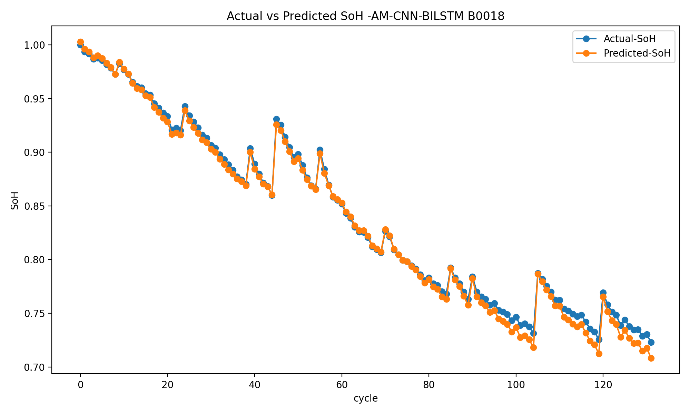
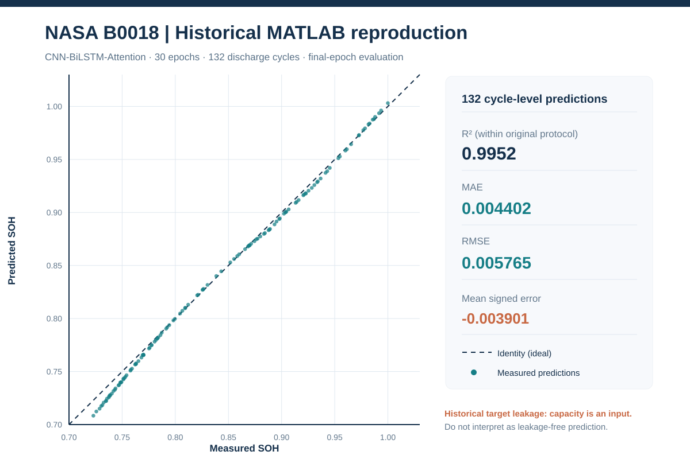

# CNN–BiLSTM with Attention for Lithium-Ion Battery SOH

TensorFlow notebook experiments for estimating lithium-ion battery State of Health (SOH) from NASA PCoE battery-aging measurements.

## Network architecture

`Discharge measurements → Conv1D → MaxPooling → Dropout → BiLSTM → Attention → SOH regression`

The experimental notebook architecture uses a 64-filter convolutional layer, 0.30 dropout, a bidirectional LSTM with 100 units, an attention stage and dense regression output. The optimizer is Adam with mean-squared-error loss.

## Battery-level experiments

| Experiment | Development cells | Independent test cell | Notebook |
| --- | --- | --- | --- |
| NASA B0018 | B0005, B0006, B0007 | **B0018** | [B0018 experiment](notebooks/CNN_BiLSTM_Attention_B0018.ipynb) |
| NASA B0030 | B0029, B0031, B0032 | **B0030** | [B0030 experiment](notebooks/CNN_BiLSTM_Attention_B0030.ipynb) |

The MATLAB-based notebooks extract sample-level voltage, current, temperature, load measurements and time information. SOH is defined relative to the initial measured capacity. Feature selection must be reviewed for target leakage in any independent evaluation.

## Datasets

The repository includes 12 NASA PCoE battery series and four CALCE CS2 series as cycle-level CSV tables in [data/processed/](data/processed/). The [dataset manifest](data/processed/manifest.json) records source checksums and conversion counts.

The two existing TensorFlow notebooks use the **original NASA MATLAB discharge traces**, not the CSV aggregates. Their MATLAB inputs are read from repository-relative paths under `data/` (for example `data/B0005.mat`). These source files are maintained separately from the versioned CSV tables. See [data documentation](data/README.md) and [source extraction guide](docs/REAL_DATA_SETUP.md) for their precise format and provenance.

## Environment

```bash
python -m venv .venv
pip install -r requirements.txt
jupyter notebook
```

Activate the environment according to the operating system before starting Jupyter. The notebooks are located in [notebooks/](notebooks/). Evaluation includes SOH curves, prediction error and training history.

## Research notes

For reproducible battery-level evaluation, keep the held-out cell outside feature selection, normalization fitting and training. The included processed tables and notebook workflows do not by themselves establish correspondence with any publication's reported benchmark scores.

The underlying battery datasets are maintained by the [NASA Prognostics Center of Excellence](https://www.nasa.gov/intelligent-systems-division/discovery-and-systems-health/pcoe/pcoe-data-set-repository/) and [CALCE/University of Maryland](https://calce.umd.edu/data). The project is distributed under the terms of its [LICENSE](LICENSE).

## Completed NASA B0018 experiment — measured results

**30-epoch CNN–BiLSTM–Attention reproduction using original NASA PCoE MATLAB discharge traces**, with B0005/B0006/B0007 for development and B0018 for the held-out battery. The model was executed in Colab, evaluated over **132 B0018 discharge cycles**, and the numerical outputs, plots and provenance files were committed to GitHub.

| Metric | **Completed Python run (B0018)** | Archived original B0018 notebook |
|---|---:|---:|
| **MAE** | **0.004402** | 0.0063 (rounded) |
| **RMSE** | **0.005765** | 0.006943 |
| **R²** | **0.995196** | Not reported in archived output |
| **MAPE** | **0.5563%** | 0.7367% |
| Epochs | 30 / 30 | 30 |

The run's RMSE is approximately **17% below** the archived notebook output (and MAE approximately **30% below** its rounded value). This comparison is **descriptive**, not an architecture improvement claim: initialization/runtime may differ and the original notebook methodology is deliberately retained.

**Important limitation:** in this historical protocol, `capacity` is both an input feature and the basis of the SOH target; test MinMax scaling is also re-fitted on B0018. These impressive **within-protocol** errors are therefore **not leakage-free cross-battery generalization**.

[**Full B0018 experiment report: metrics, five figures, data and limitations**](results/legacy_mat_b0018_e30_seed42/README.md)

### Measured SOH and model predictions



### Per-cycle actual/predicted SOH parity



For further diagnostics, see the [signed residuals](results/legacy_mat_b0018_e30_seed42/signed_residuals_B0018.svg), [absolute-error distribution](results/legacy_mat_b0018_e30_seed42/absolute_error_distribution_B0018.svg) and [30-epoch learning curves](results/legacy_mat_b0018_e30_seed42/training_convergence.png). Full source values are in [metrics.json](results/legacy_mat_b0018_e30_seed42/metrics.json), [test_predictions.csv](results/legacy_mat_b0018_e30_seed42/test_predictions.csv) and [training_history.csv](results/legacy_mat_b0018_e30_seed42/training_history.csv).

The original `.keras` model and recovery checkpoints are retained in the owner's Google Drive, **not** in GitHub. B0030 is a distinct experiment; do not carry B0018's metrics over to it. 

## Fully resumable Colab training from the included NASA CSV data

For a **new, leakage-aware cycle-level evaluation**, use the
[resumable Colab notebook](notebooks/train_resumable_colab.ipynb) and
[training/recovery guide](TRAINING_RECOVERY.md). The 30-epoch B0018 trial
trains on B0005/B0006, validates on B0007 and tests only on B0018;
features exclude battery capacity and target columns, and MinMax scaling
uses training cells only. Keras saves model + optimizer state to
**persistent Google Drive** after each epoch. It can resume with
`--resume`; small scientific reports can be published to GitHub.

This is **not** an exact re-run of the historical notebooks: they require
original NASA MATLAB discharge samples, which are not versioned in this
repository, and use a different input representation. Do not attribute
results of the new CSV workflow to the original paper.

## Original NASA MATLAB notebook reproduction (historical protocol)

The two exact original sample-level notebooks have now been adapted to Colab
with verified NASA `.mat` retrieval, per-epoch full-Keras checkpoints on Drive,
and automatic resume after a Colab interruption:

- [B0018 original-MAT Colab reproduction](notebooks/REPRO_ORIGINAL_MAT_B0018_COLAB.ipynb)
- [B0030 original-MAT Colab reproduction](notebooks/REPRO_ORIGINAL_MAT_B0030_COLAB.ipynb)
- [Reproduction instructions and methodological limitations](REPRODUCE_ORIGINAL_MAT.md)

**Scientific warning:** this deliberately retains the original capacity-based
input target leakage and test-set scaling convention. The numerical metrics
cannot be described as leakage-free generalization. The separate cycle-level
CSV experiment and its earlier checkpoint/results are preserved unchanged.


## Standalone Python training (no notebook execution)

The original MATLAB experiments can now be run directly from the
[Python pipeline](legacy_mat_pipeline/) instead of executing the Colab
`.ipynb` files. The original notebooks remain intact.

After installing `requirements.txt` and mounting Google Drive in Colab:

```bash
python -m legacy_mat_pipeline --experiment B0018 --run-root /content/drive/MyDrive/NASA_CNN_BiLSTM_Attention
```

Use `--experiment B0030` for the second original experiment. The runner
downloads and validates the NASA `.mat` inputs, preserves the original
seven features (including capacity), trains for 30 epochs, resumes full
Keras checkpoints, computes metrics after cycle-wise averaging and saves
plots plus reports. See the [Python usage guide](legacy_mat_pipeline/README.md)
for Colab setup and output paths. This remains an archival reproduction
with known target leakage, not a leakage-free SOH benchmark.
