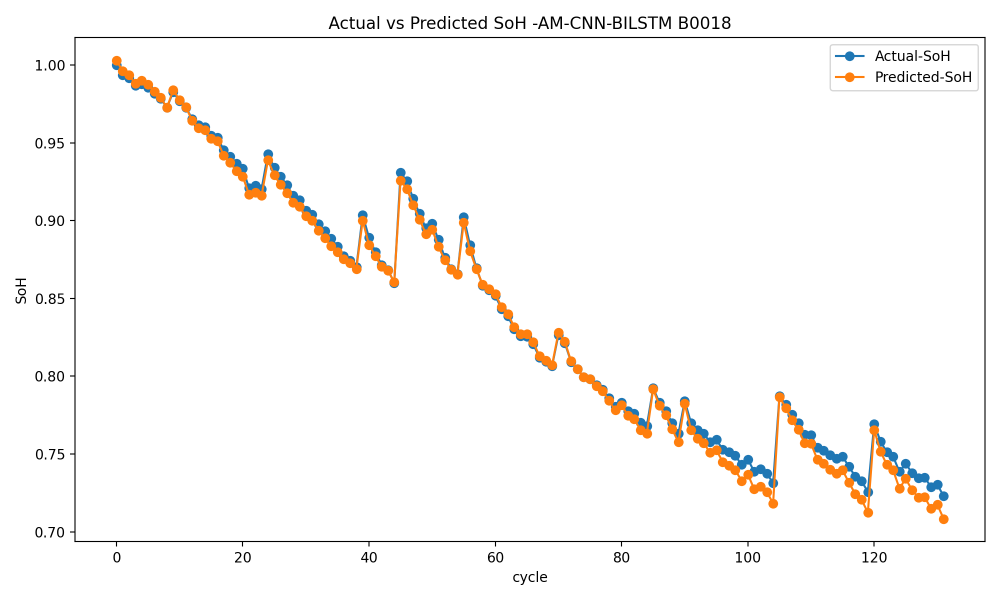
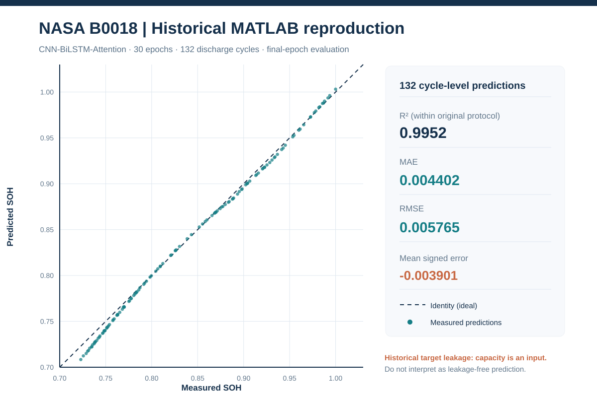
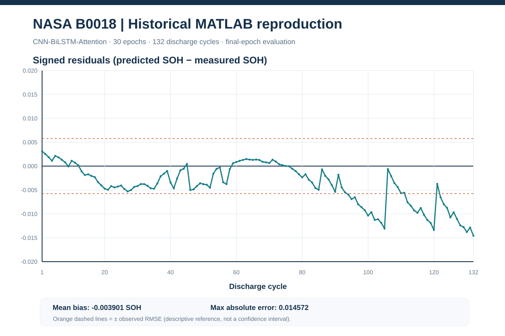
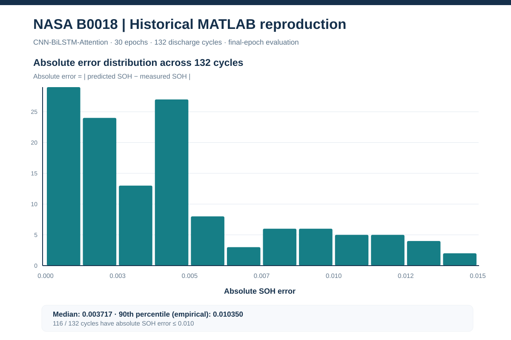
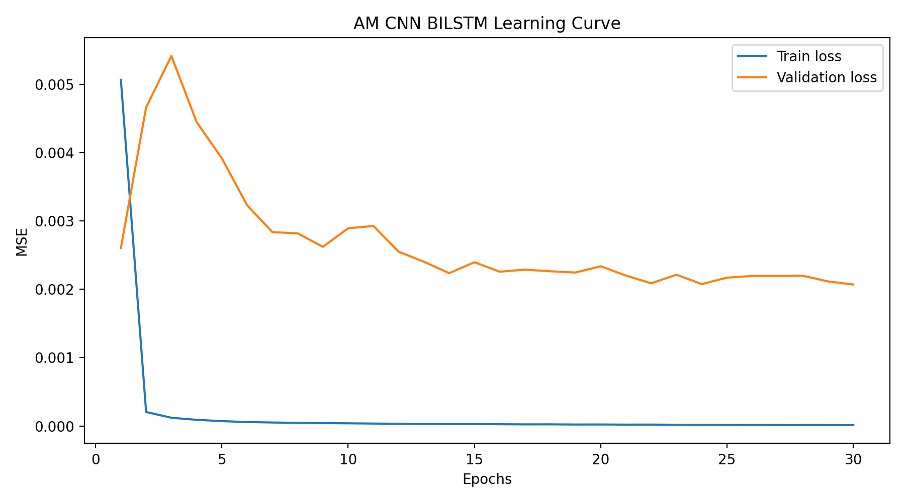

# NASA B0018 — CNN–BiLSTM–Attention (original MATLAB protocol)

**Completed:** 30 / 30 epochs  ·  **Test battery:** B0018 (132 discharge cycles)  ·  **Seed:** 42  ·  **Source:** original NASA PCoE `.mat` discharge measurements.

> **Interpretation boundary:** These are real, independently regenerated *numerical outputs* of the archived notebook protocol, **not leakage-free forecasting evidence**. The historical model receives the same-cycle `capacity` measurement used to define its SOH target; the test scaler is re-fitted to the test battery. The 80/20 training/validation split also mixes sample-level observations from the same battery cycles. Consequently, the strong metrics below must not be presented as unbiased cross-battery SOH generalization.

## Measured performance — final-epoch model

| Metric | B0018 Python run | Interpretation |
|---|---:|---|
| **MAE** | **0.004401576** | 0.4402 SOH percentage points |
| **RMSE** | **0.005764996** | 0.5765 SOH percentage points |
| **R²** | **0.995196321** | Fit to 132 per-cycle targets under historical protocol |
| **MAPE** | **0.5563219 %** | Relative absolute error |
| MSE | 0.00003323517 | Mean squared residual |
| Epochs | 30 | Model from the final epoch |
| Test cycles | 132 | One held-out battery, not 132 independent batteries |

The original saved B0018 notebook output records MAE **0.0063** (rounded) and RMSE **0.006942938**. For **this specific historical protocol**, the new run gives approximately **30% lower MAE** and **17% lower RMSE** than that archived numerical output. This is a comparison between recorded runs, **not** a controlled scientific demonstration of architectural improvement. The notebook uses a different random initialization/runtime; no repeat-seed uncertainty or statistical significance is established here.

## Figures from recorded predictions and training history

### 1. SOH trajectory across the 132 B0018 discharge cycles

The original test-time predictions are averaged over individual discharge measurements **within each cycle** before computing reported errors. The curve broadly follows the measured SOH trajectory, including recovery-like variations present in this cell.

### 2. Parity plot — actual versus predicted cycle-level SOH

The dashed identity line indicates perfect equality. All 132 points are plotted; this is a per-cycle diagnostic, not a cross-dataset or uncertainty calibration plot.

### 3. Residuals by cycle — bias and late-life behavior

Residual = predicted SOH − observed SOH. From the committed predictions: signed mean error is **−0.003901**, maximum absolute error **0.014572**; the last ten cycles have a mean signed residual of approximately **−0.011462**. The model therefore tends to **underestimate later-cycle SOH**, despite the excellent overall R². The orange lines mark ± the *observed* RMSE and are **not** confidence bands.

### 4. Distribution of absolute errors

The median absolute error is approximately **0.003717**; **116 of 132 cycles** have absolute error at most **0.010** SOH (1.0 percentage point). This is descriptive of the B0018 historical-protocol run and does not quantify uncertainty for other batteries.

### 5. Training/validation learning curves

Training MSE at epoch 30: **0.000014026**; sample-level validation MSE: **0.002070314**. These training/validation losses are **not directly comparable** to the published test MSE (0.000033235), which is computed **after averaging predictions by cycle**, and with historical test-time scaling. Do not infer universal generalization from their different scales.

## Exact experimental conditions

| Component | Recorded protocol |
|---|---|
| Development batteries | B0005, B0006, B0007 |
| Test battery | B0018 |
| Data | Original NASA PCoE discharge-trace `.mat` files |
| Network | Conv1D(64, k=3) → MaxPool(2) → Dropout(0.3) → BiLSTM(100, ReLU) → Dense(200, sigmoid) gate → Multiply → Dense(1, ReLU) |
| Input features | `capacity`, `voltage_measured`, `current_measured`, `temperature_measured`, `current_load`, `voltage_load`, `time` |
| Target | Each discharge's capacity divided by the first capacity of the respective protocol's data |
| Train/validation | Random sample-level 80/20, `random_state=0` |
| Scaler | MinMax fit before development split; separately refit on held-out B0018 (historical behavior) |
| Optimization | Adam, MSE, batch 32, 30 epochs, seed 42 |
| Test reporting | Last epoch; predictions averaged by discharge cycle; MAE/RMSE/MSE/MAPE/R² on 132 per-cycle estimates |
| Recovery | Full Keras model and optimizer checkpoint every completed epoch; last two retained on Drive |

## Reproducible files and model availability

- [Exact experimental metrics](metrics.json) (machine-readable)
- [Original protocol configuration, including source `.mat` hashes](config.json)
- [Per-cycle measured and predicted SOH values](test_predictions.csv)
- [All 30 training and validation loss records](training_history.csv)
- [Original publication manifest with SHA-256 hashes](manifest.json)
- [Executable Python pipeline](../../legacy_mat_pipeline/README.md)

The complete `AM_CNN_BILSTM_B0018.keras` model and its final checkpoints (`epoch_0029.keras`, `epoch_0030.keras`) remain in the owner's Google Drive at:

`MyDrive/NASA_CNN_BiLSTM_Attention/legacy_mat_b0018_e30_seed42/`

Weights, raw MATLAB data and personal credentials are intentionally **not** part of this GitHub results folder. The B0030 experiment is a separate run and must not be inferred from B0018.

*Figures `parity_B0018.svg`, `signed_residuals_B0018.svg` and `absolute_error_distribution_B0018.svg` were derived directly from the versioned `test_predictions.csv`. The two PNG figures and metric JSON were generated during the actual Colab training and result publication. No unseen experiments or test outcomes have been added.*
