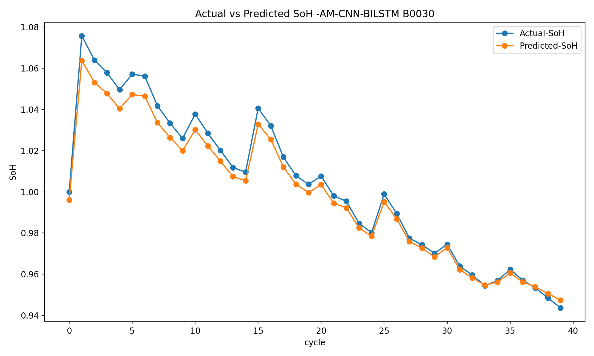
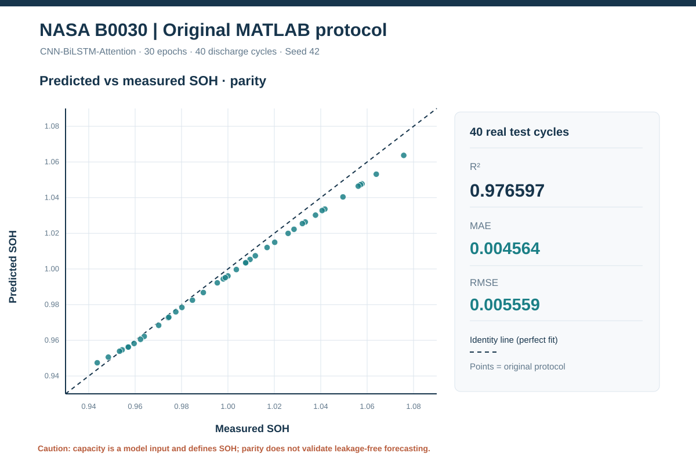
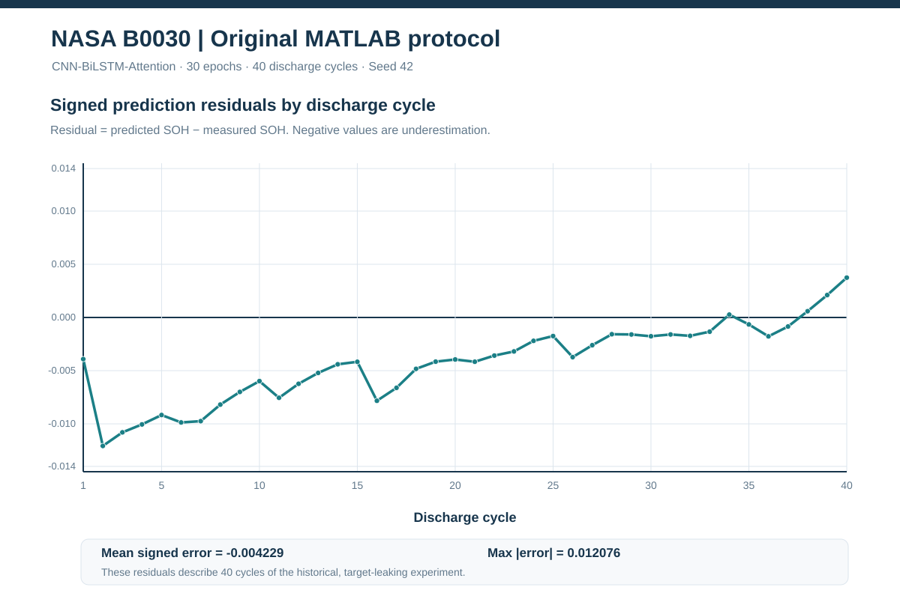
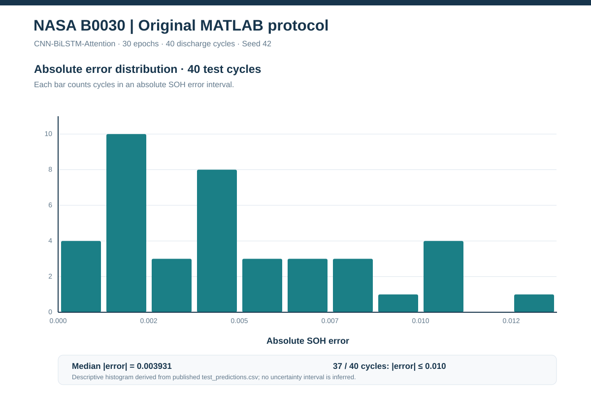
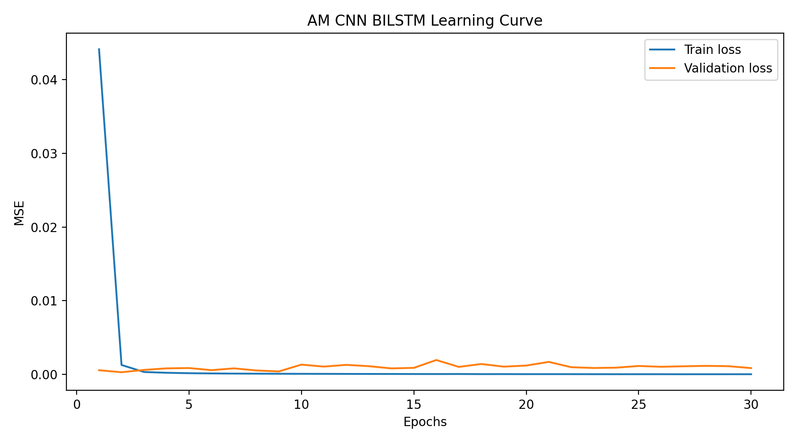

# NASA B0030 — CNN–BiLSTM–Attention (original MATLAB protocol)

**Completed:** 30/30 epochs · **Test:** B0030, 40 discharge cycles · **Seed:** 42 · **Source:** original NASA PCoE `.mat` time-sample discharge traces.

> **Scientific caution:** This deliberately reproduces the historical notebook, **including target leakage**: the model uses discharge-cycle `capacity` as an input even though this capacity defines the SOH target. It also re-fits MinMaxScaler to the test battery and randomly mixes sample-level measurements from the same cycles between train and validation. These figures represent faithfully recorded outputs of the historical protocol — **not leakage-free forecasting or evidence of cross-battery deployment performance**.

## Verified measured performance

| Metric | **Python run B0030** | Archived notebook B0030 |
|---|---:|---:|
| **MAE** | **0.004563940** | 0.0053 (rounded) |
| **RMSE** | **0.005558571** | 0.006686304 |
| **R²** | **0.976597052** | Not reported in archived output |
| **MAPE** | **0.444860 %** | 0.546210 % |
| MSE | 0.00003089771 | 0.00004470666 |
| Test discharge cycles | 40 | 40 |
| Training epochs | 30 | 30 |

Relative to the saved notebook result, **RMSE is ~16.9% lower**, **MAE is ~13.9% lower** (the historical MAE was rounded), and MAPE is ~18.6% lower. These are *descriptive comparisons of two runs of the same flawed historical protocol*, not new-method gains, significance tests, or a demonstration of generalization.

## Figures from actual B0030 measurements and predictions

### 1. Measured and predicted SOH across 40 discharge cycles

Predictions come from individual discharge measurements averaged **by cycle** before computing the test metrics. The recorded first-cycle reference is 1.0; 20 of the 40 cycle SOH values exceed 1.0 because of the original first-observation normalization and measurement variation. This is not an error in the plotting scale.

### 2. Parity: actual versus predicted SOH

The dashed diagonal represents perfect agreement. All 40 recorded cycle-level predictions are included, without synthetic data or smoothing.

### 3. Signed residuals by cycle

Using **predicted minus measured SOH**, the mean signed residual is **−0.004229**. The first 10 cycles average **−0.008680**, whereas the last 10 average **−0.000124**. Underestimation in this run is concentrated near the **beginning** of the test trajectory, rather than being uniform across the battery's life.

### 4. Absolute-error distribution

The median absolute SOH error is **0.003931**, maximum is **0.012076**, and **37/40 cycles** have absolute error of **0.010 or lower**. These describe this test battery and do not provide predictive uncertainty for new cells.

### 5. Training convergence

The **epoch-30** training MSE is **0.000016583**; the validation MSE is **0.000846636**. The minimum recorded validation MSE is **0.000286771 at epoch 2**. The archived notebook protocol deliberately evaluates the **last epoch**, not the validation-best epoch. Do not directly compare these sample-level losses with test MSE **0.000030898**, which is calculated **after cycle-level averaging and separately re-fitting the test scaler**.

## Comparison with the other completed MATLAB replication

| Measurement | B0018 Python reproduction | B0030 Python reproduction |
|---|---:|---:|
| Test battery | B0018 | B0030 |
| Test cycles | 132 | 40 |
| MAE | 0.004401576 | 0.004563940 |
| RMSE | 0.005764996 | 0.005558571 |
| R² | 0.995196321 | 0.976597052 |
| MAPE | 0.556322% | 0.444860% |
| Epochs | 30 | 30 |

B0030 has **slightly lower RMSE** and MAPE but slightly higher MAE; B0018 has higher R². The R² values are **not directly comparable as an architecture ranking**, since each battery has a different SOH variance and only 40 test cycles are available for B0030. Both runs reuse the target-leaking historical approach; these numerical contrasts do not establish robustness to other cells.

[View the corresponding B0018 complete report](../legacy_mat_b0018_e30_seed42/README.md).

## Exact conditions and reproducibility

| Parameter | Recorded value |
|---|---|
| Raw data | NASA PCoE `.mat` time-sample discharge traces |
| Development batteries | B0029, B0032, B0031 |
| Test battery | B0030 |
| Inputs | `capacity`, `voltage_measured`, `current_measured`, `temperature_measured`, `current_load`, `voltage_load`, `time` |
| Target | SOH computed from capacity relative to the first observed capacity (original notebook convention) |
| Train/validation | 80/20 random sample-level split, `random_state=0` |
| Scaling | MinMax fitted before splitting development measurements; refitted on B0030 at test time |
| Model | Conv1D(64,k=3) → MaxPool(2) → Dropout(0.3) → BiLSTM(100, ReLU) → sigmoid Dense(200) gate → Multiply → ReLU Dense(1) |
| Training | Adam, MSE, batch size 32, seed 42, 30 epochs |
| Test metrics | Predictions averaged by discharge cycle, then MAE, RMSE, MSE, MAPE, R² |
| Checkpoints | Full Keras model + optimizer on the owner's Google Drive |

Versioned evidence: [metrics.json](metrics.json), [config.json](config.json) (including source `.mat` SHA-256 hashes), [test_predictions.csv](test_predictions.csv) (40 rows), [training_history.csv](training_history.csv) (30 epochs), and the original [publication manifest](manifest.json). Source implementation: [standalone Python pipeline](../../legacy_mat_pipeline/README.md).

The final `AM_CNN_BILSTM_B0030.keras` model and the latest two `.keras` checkpoints are retained outside GitHub at:

`MyDrive/NASA_CNN_BiLSTM_Attention/legacy_mat_b0030_e30_seed42/`

The three new SVG diagnostics were calculated directly from the committed **B0030** `test_predictions.csv`, while the original PNGs were generated in Colab. The recorded numeric result files have not been altered and no additional experiments have been invented.
